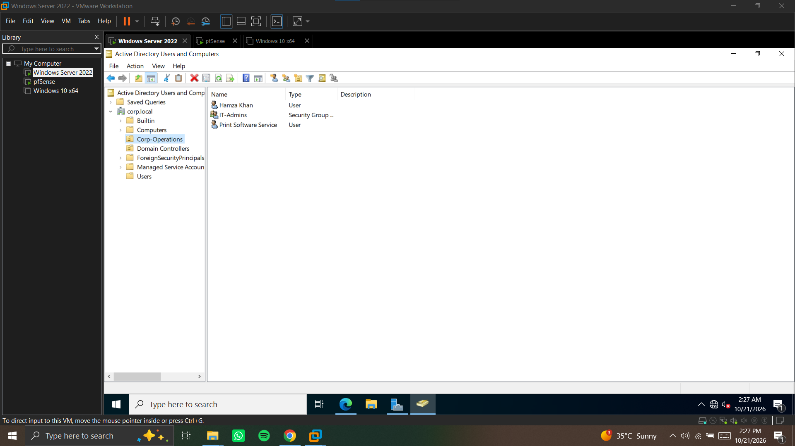
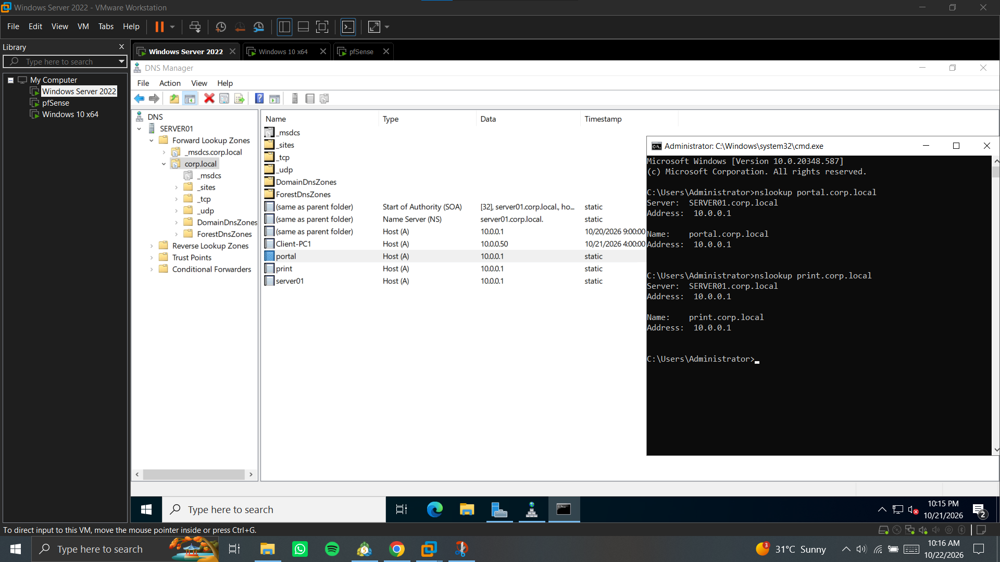
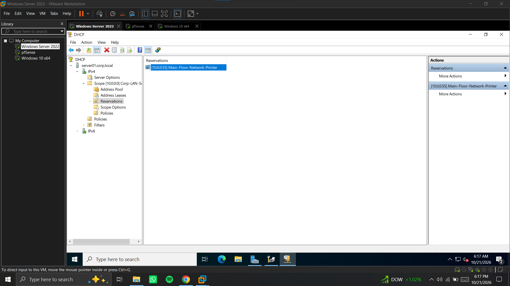
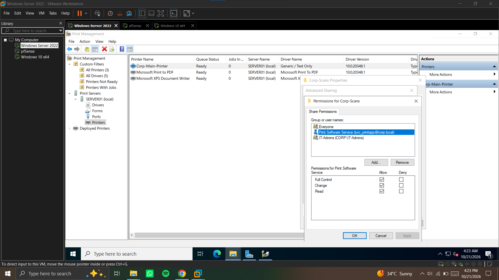
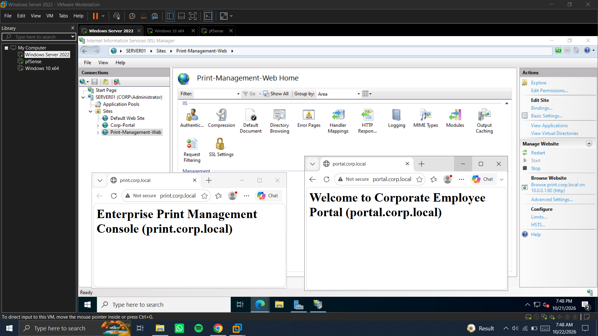
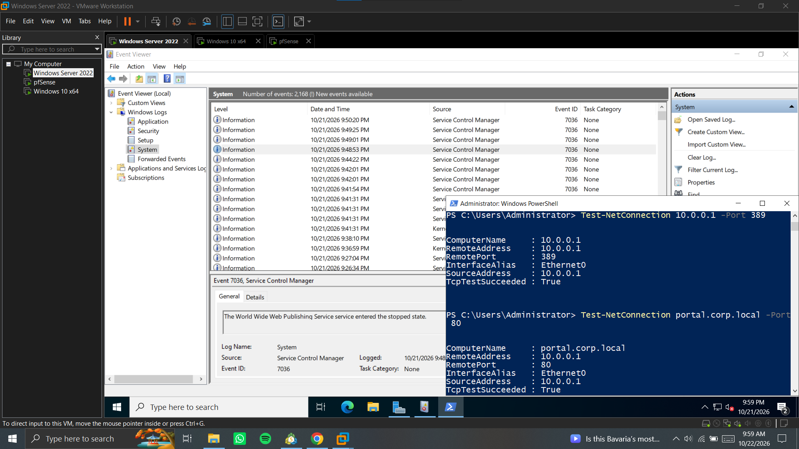

# 🖥️ Windows Server 2022 Enterprise Infrastructure Lab

## 📌 About This Project
In this lab, I built and configured a complete corporate network infrastructure from scratch using **Windows Server 2022 (`SERVER01`)**. I set up core server roles used in enterprise environments, including **Active Directory, DNS, DHCP, Print Server, SMB File Sharing, and IIS Web Server**, and performed system and port troubleshooting using **Event Viewer** and **PowerShell**.

---

## 🖧 Server Roles & Port Summary

| Role / Service | IP & Port | Details & Purpose |
| :--- | :--- | :--- |
| **Active Directory (`AD DS`)** | `10.0.0.1` (`Port 389`) | Domain Controller for `corp.local`, OUs, users, security groups, and LDAP service account |
| **DNS Server** | `10.0.0.1` (`Port 53`) | Forward Lookup Zone (`corp.local`), Reverse Lookup Zone (`10.0.0.x`), `A` & `PTR` records |
| **DHCP Server** | `10.0.0.1` (`Port 67/68`) | IPv4 Scope (`10.0.0.50` – `10.0.0.150`) and MAC IP reservation (`10.0.0.55`) |
| **Print Server (`Spooler`)** | `10.0.0.55` (`Port 9100`) | Centralized TCP/IP network printer (`Corp-Main-Printer`) listed in Active Directory |
| **File Server (`SMB`)** | `10.0.0.1` (`Port 445`) | Shared folder (`\\10.0.0.1\Corp-Scans`) with Share and NTFS security permissions |
| **Web Server (`IIS`)** | `10.0.0.1` (`Port 80`) | Hosting two internal portals (`portal.corp.local` & `print.corp.local`) using Host Headers |

---

## 🛠️ What I Configured in This Lab

* **Active Directory & Service Account Setup:** Promoted `SERVER01` (`10.0.0.1`) to a Domain Controller for `corp.local`. Created the `Corp-Operations` OU, domain user accounts, the `IT-Admins` security group, and a dedicated non-expiring Service Account (`Print Software Service`) for third-party software and LDAP integration.
* **DNS Forward & Reverse Lookup:** Configured Forward and Reverse Lookup Zones in DNS Manager. Added `Host (A)` and `PTR` records so internal websites and servers resolve properly by name and IP using `nslookup`.
* **DHCP Scope & Printer IP Reservation:** Created an active IPv4 scope (`10.0.0.50` – `10.0.0.150`) authorized in Active Directory, and configured a MAC address reservation (`10.0.0.55`) so the network printer always gets the same fixed IP.
* **Enterprise Print & SMB File Server:** Installed Print and Document Services to manage `Corp-Main-Printer` over TCP/IP Port `9100`. Created a shared network folder (`C:\Corp-Scans`) for network scanning with restricted SMB Share and NTFS permissions.
* **IIS Multi-Website Hosting:** Installed IIS Web Server and hosted two internal web applications (`http://portal.corp.local` and `http://print.corp.local`) on a single IP (`10.0.0.1`) and Port `80` using HTTP Host Headers and separate Application Pools.
* **System Logs & Port Troubleshooting:** Used Windows `Event Viewer` (`System`, `Application`, and `Security` logs) to track service states and tested open network ports (`80`, `445`, `389`) using PowerShell `Test-NetConnection`.

---

## 📸 Lab Screenshots

### 1. Active Directory Users, Groups & Service Account (`AD DS`)
Created the `Corp-Operations` OU inside `corp.local` with domain users, the `IT-Admins` security group, and a dedicated Service Account.

---

### 2. DNS Forward & Reverse Lookup Zones
Configured DNS zones and `Host (A)` records for `SERVER01`, `portal.corp.local`, and `print.corp.local` pointing to `10.0.0.1`.

---

### 3. DHCP Scope & Network Printer IP Reservation
Configured the corporate LAN DHCP scope and reserved `10.0.0.55` for the network printer using its MAC address.

---

### 4. Centralized Print Server & SMB Shared Folder Permissions
Added the TCP/IP printer in Print Management and configured SMB Share and NTFS Security permissions on the `Corp-Scans` folder.

---

### 5. IIS Multi-Website Hosting Using Host Headers
Running two separate web portals (`print.corp.local` and `portal.corp.local`) simultaneously on `SERVER01` (`10.0.0.1:80`).

---

### 6. Event Viewer Diagnostics & PowerShell Port Testing
Checking Windows service events in Event Viewer and verifying open ports (`80`, `445`, `389`) with `Test-NetConnection`.

---

## 👨‍💻 Author
**Mohammad Hamza Bashir**  
*IT Support & System Administration*  
📍 Karachi, Pakistan  
📧 hamzabashirkhan678@gmail.com
